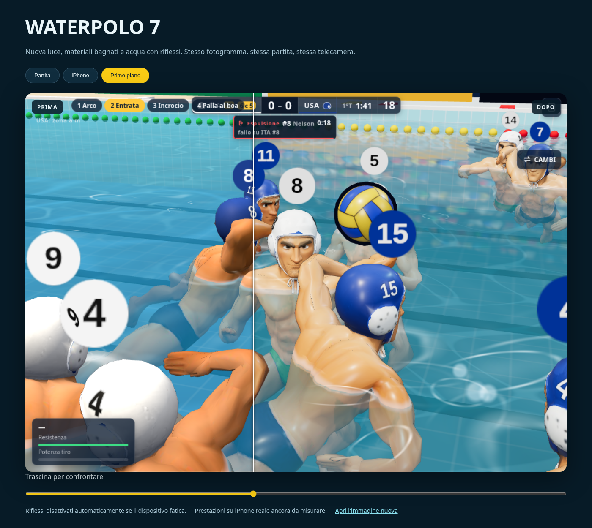

# Resa dell'arena

Passata grafica basata su v0.36, commit `b5152b1`. Conserva il modello cartoon,
le telecamere e la simulazione. Non richiede nuovi file scaricati o dipendenze.

- `grafica/illuminazione.js`: ambiente luminoso prefiltrato una volta, esposizione
  ACES, luce di riempimento e ombre morbide instanziate sotto i corpi.
- `grafica/corpo.js`: materiale fisico con strato lucido per pelle, costume e
  calottina, conservando ricolorazione, personalizzazione ed espressioni.
- `grafica/superficie.js`: piccole onde geometriche, normali analitiche, Fresnel e
  riflesso planare della scena a 384 × 192, senza multisampling. Gli indicatori
  numerici dei giocatori sono esclusi dal riflesso.
- `grafica/sottacqua.js`: attenuazione in profondità e caustiche deformate.
- `main.js`: dopo due controlli lenti consecutivi toglie prima il passaggio del
  riflesso. Ai successivi controlli può abbassare il DPR, come prima.

## Verifica

```
npm run build
npm run lint
node tests/grafica-arena.mjs --no-build
npm run acqua-effetti -- --no-build
```

Il test grafico impone frame da 33 ms per verificare il ripiego automatico:
**non misura gli FPS del computer o di un iPhone**. Controlla anche che il DPR non
scenda prima di aver tolto il riflesso, che i ridisegni non creino texture e che il
canvas segua il cambio di dimensioni.

Nel confronto con la build precedente, su tre inquadrature identiche dopo 25 s
simulati, stato della partita e coordinate di palla/giocatori coincidono. La resa
massima aumenta le chiamate di disegno: nella scena iPhone di confronto da 90 a
168. Nel test del ripiego il conteggio scende da 194 a 90 mantenendo il DPR 1,5.
Sono scene diverse, non benchmark di velocità. Le prestazioni e la temperatura
durante una partita lunga vanno misurate su Safari/iPhone reale.

Non aggiornare automaticamente gli screenshot di riferimento: il nuovo aspetto
va confrontato e approvato visivamente prima di sostituirli.

## Confronto visivo


