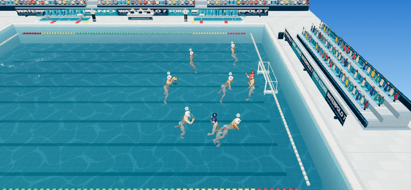
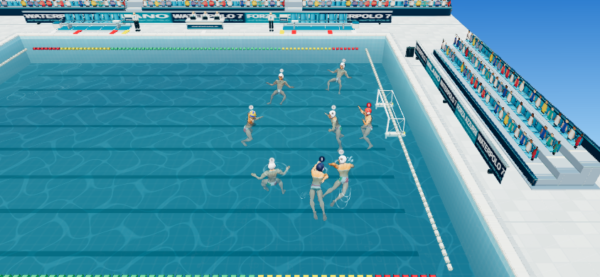
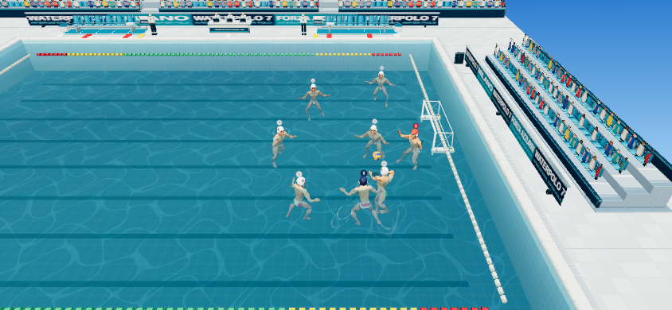
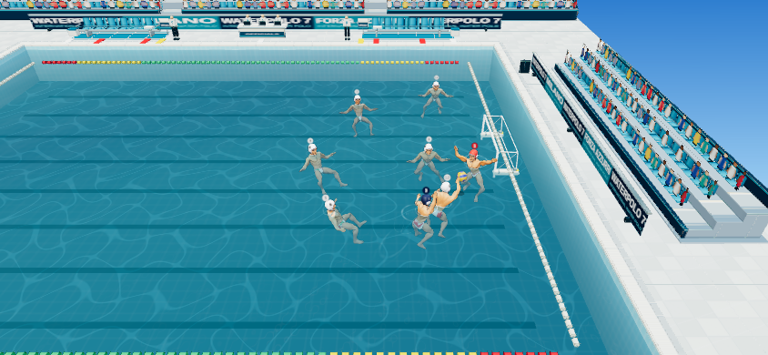

# Mezza entrata: dal vantaggio al tiro

Scena iniziale preparata, poi ciclo reale della partita: la Pos. 1 entra, la Pos. 3 legge il vantaggio e la serve. Nessun passaggio, presa o tiro imposto dallo strumento. Il marcatore nuota e gli altri difensori rientrano da lontano; questa prova isola l'occasione e non rappresenta una partita libera o una difesa già schierata.

Camera fissa soltanto per confrontare i quattro stati, senza cambiare la regia del gioco. Tempi di simulazione a 60 Hz, non misure degli FPS di un telefono. Gli indici in [stati.json](../verifiche/v068/mezza-entrata-fotogrammi.json) sono quelli interni del codice, distinti da posizioni e numeri di calotta.

1. **0,017 s — parte lo scatto breve.** Il giocatore ha già la testa davanti; il compagno esterno conserva il suo spazio.

2. **0,517 s — il portatore sceglie il servizio.** Il ricevente è entrato nella finestra utile; il passaggio partirà a 0,700 s.

3. **1,033 s — presa reale.** La palla raggiunge il compagno, che resta davanti al proprio marcatore.

4. **1,483 s — tiro rilasciato.** La prova richiede un tiro effettivo e non un gol garantito.

Le quattro combinazioni destra/sinistra del campo e mano destra/sinistra passano la stessa prova. Da ala ancora larga o con il difensore davanti, il motore rinuncia alla mezza entrata. Un margine di 20 cm rispetto ai 5 m evita di fermarsi appena fuori dalla finestra di ricezione; lo scatto resta fra 0,6 e 1,4 m.
