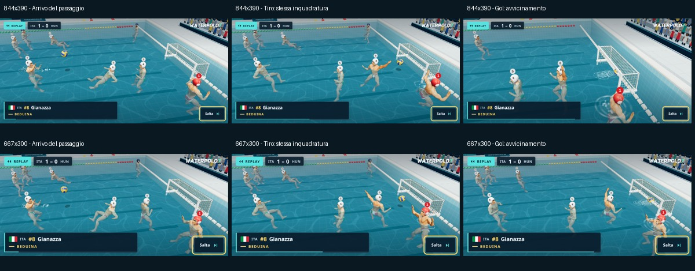

# v0.48 — replay leggibile, regia e bordovasca

Base main `933654b` dopo l'unione della PR #43 v0.47; CI main `43826566084` verde. Branch `codex/v048-replay-regia-leggibile`. Ale ha autorizzato di continuare verso un replay più ambizioso, precisando che deve essere comprensibile.

## Sequenza

1. **0–0,6 s: diretta.** Si vede subito il gol.
2. **0,6–5,8 s: replay saltabile.** Fino a tre secondi della sequenza realmente registrata: ultimo tratto del passaggio, ricezione, alzata, tiro, rete e reazione. La camera resta ferma durante ricezione e intero volo; il rallenty segue il rilascio e l'ingresso della palla, anziché una percentuale fissa del filmato.
3. **Dopo il gol:** avvicinamento progressivo dallo stesso lato, conservando l'orientamento. Ultimo quinto del filmato dedicato alla reazione vera del marcatore. Se nome/numero cambiano per una sostituzione, niente primo piano del nuovo entrato attribuito a chi ha segnato.
4. **5,8–7 s: rimessa originale.** Restano 1,2 s di preparazione al centro. «Salta» elimina il resto del filmato.

Nessun taglio durante il volo, rotazione di180°, scia artificiale o nuovo contorno sulla palla. La camera considera le proiezioni di palla, tiratore, portiere e porta, insieme ai margini del telefono e alle scritte reali del replay. Dei passaggi lunghi conserva l'arrivo al ricevente, evitando di allargare inutilmente fino al punto di partenza.

Durante la clip il motore è fermo. La conclusione o il salto attraversano una volta sola i due secondi residui dello stop originale del gol: stessi recupero, cambi, espulsioni, cronometri, statistiche e rimessa della v0.47. I 5,2 s di riproduzione non danno vantaggi di stamina. Senza archivio valido si mantiene la diretta con la vecchia attesa. Pausa, rotazione e scheda nascosta chiudono la presentazione. Risultato e premiazione aspettano la fine del filmato, anche nel ramo `over` sulla sirena.

## Grafica e file

- `src/grafica/replay.js`, nuovo `src/grafica/replay-camera.js`: eventi ricavati dai campioni, pose e identità registrate, camera stabile, rallenty e avvicinamento. Conservato il ripristino protetto da `finally`, compresi errori del renderer.
- `src/replay.js`, `src/replay-regia.js`, `src/main.js`, `src/grafica/render.js`, `src/menu.js`: durata5,2s, freeze solo dopo archivio valido, fine/salto, input e orientamento, risultato/premiazione differiti. Il render anticipato del replay evita di aggiornare il rig e gli effetti live durante la clip.
- `src/grafica/pose.js`: piccola esultanza vera, una mano alzata dopo la palla in rete, soltanto per il marcatore ancora riconoscibile. Nessuna nuova geometria o modifica a nuoto/tiro/gambe.
- `src/grafica/arena.js`, `src/grafica/scena.js`: cimasa con spessore/smusso, dettaglio di griglia e panchine, due tribune basse dietro le porte; stessa mesh/atlante1024². Arena388→552tri, **+164**. Quattro pareti accorpate in una mesh, stesse facce/UV/materiale e48tri. Porte e corde conservate.
- `tests/replay-v047.mjs` sostituito da `tests/replay-v048.mjs`; `npm run replay` punta al test attuale. La prova UI esistente resta valida. `package*.json`0.48.0; rapporto, misure, CLAUDE.md e i due passaggi aggiornati.

I sei PNG completi sono in `docs/immagini/v048-replay-regia-{844x390,667x300}-{1,2,3}.png`: arrivo del passaggio, tiro e reazione, da una beduina entrata fisicamente in rete. Ispezionati prima della chiusura. La cattura preserva il canvas nello stesso task del draw perché il RAF del test è finto.

## Misure e controlli

Numeri grezzi/provenienza in `misure-replay-v048.json`. Ambiente Chromium/SwiftShader Linux, non un iPhone fisico.

| Controllo | Esito misurato |
| --- | --- |
| Nuoto → passaggio → ricezione → tiro → gol fisico | PASS |
| Durata senza salto | 7,000 s, di cui5,2 replay; tempo di gioco invariato |
| Freeze del motore per un secondo di playback | Stato, timer, stamina, cambi e statistiche invariati |
| Scena/matrici/materiali/FX/RNG, anche su errore del draw | Ripristino esatto PASS |
| Fine/Salta, pausa, rotazione, reset, archivio assente, rigori esclusi | PASS |
| Risultato dopo1,65s reali e rotazione nel replay finale | PASS: niente menu/premiazione nascosti; risultato disponibile dopo uscita |
| Cambio immediato del marcatore | Identità originale conservata; avvicinamento disabilitato sul nuovo entrato |
| Leggibilità | **18 sequenze ×31 progressi =558 fotogrammi**, due direzioni, tiro da fuori/ala/palombella,844×390 e667×300, anche margini44/44/21 |
| Punti verificati | Palla, testa e mano del tiratore, quattro angoli porta dentro schermo/margini e fuori dalle scritte; camera ferma fino alla rete e stesso orientamento durante l'avvicinamento |
| Diametro minimo palla | **5,460 pixel CSS** nei campioni; soglia minima4px conservata |
| Replay con due comparse vere,844×390 e667×300 DPR1,5 | Entrambe max **49 chiamate /146.360tri**;14corpi completi |
| Diretta con due cambi,844×390 e667×375 DPR1,5 | Entrambe max **62 chiamate /147.652tri** |
| 34 episodi con identità differenti | Max **16.676.528byte contati**,19texture finali, tetto32; archivio≤106campioni |

La prova dell'ala inizialmente trovava una parata reale: per isolare la camera il portiere della fixture è ora dal lato opposto al tiro. I gol delle prove di leggibilità attraversano fisicamente la linea; nessun assert ridotto e nessuna modifica alla parata in produzione.

`npm run lint`, `npm run build`, `npm run replay -- --foto`, `npm run replay-ui`, `npm run verifica -- --partite=0` e `npm run aspetto -- --no-build`: **PASS locali**. Aspetto: gambe fuori0/4375,0/7740,0/1395; iPhone59/142480 e58/142224. Cinque immagini ispezionate: nuove tribune/bordo e versione, posizioni di gioco identiche. Riferimenti aggiornati, confronto finale identico su tutti e cinque i PNG. Le sei partite di `npm run verifica` e tutte le regressioni vengono eseguite una sola volta nella CI del branch; collegamento e SHA definitivi nella PR. Non considerare PASS un controllo soltanto avviato.

## Decisioni precedenti superate esplicitamente

- Su autorizzazione di Ale, la presentazione totale3,8s della v0.47 diventa **7s saltabili**:0,6diretta+5,2replay+1,2rimessa. L'avanzamento regolamentare dello stop resta quello originale, senza recupero aggiuntivo.
- Regia v0.47 ricalcolata dai giocatori vicini a ogni fotogramma → **inquadratura fissa per tutta l'azione**, breve avvicinamento soltanto dopo il gol. Stesso lato del campo e nessuna inversione.
- Il bordovasca v0.47 riceve due testate basse e un bordo con spessore. Un solo atlante e nessun nuovo passaggio di disegno.

Restano nuoto v0.45, regole/IA v0.46, camera unica durante il gioco attivo, SPEED1, sprint a tocchi, riflesso solo alta, MAX0,9s/tiro al rilascio, logo C e CAMBI in basso. Limiti iPhone stretti **<100chiamate/<150.000tri anche con due cambi**, senza deroghe;14corpi interi.

## Limiti e non fatto

I controlli proiettivi non sono una misura di tutte le possibili occlusioni fra corpi. Le sei immagini sono state controllate, ma il giudizio di fluidità e leggibilità su iPhone fisico resta ad Ale; nessuna promessa FPS. Memoria contata: buffer e copie RGBA delle cuffie, non intero heap o memoria GPU.

Nessun primo piano estremo, campo/arena fotorealistici, tribune animate, nuovo GLB delle porte, replay manuale o serie di rigori, telecronaca, barra oscillante del tiro, bonus arcade, Sfide lampo o progressione. Nessun merge/deploy.
