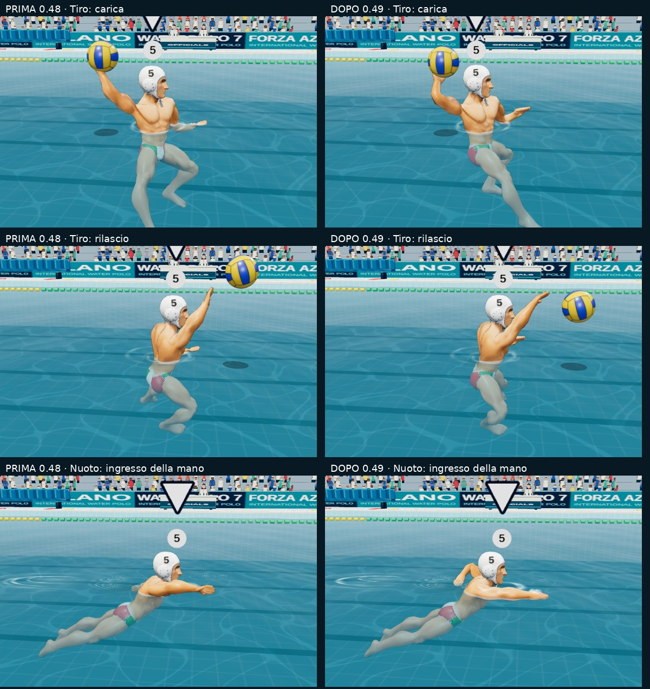

# v0.49 — gomiti, polsi e torsione del busto

Base main `19c213d` dopo PR #44 v0.48; branch `codex/v049-gesti-articolati`. Ale ha segnalato giocatori rigidi, gomiti/polsi poco articolati e busto fermo. Il lavoro interviene sul modello e sui gesti sia in diretta sia nelle pose registrate dal replay.

## Cause trovate e correzioni

- Il primo figlio della mano nel GLB è `presa_*`, inclinato circa27°: veniva usato come asse delle dita. Le basi di rotazione risultavano non ortogonali e le rotazioni delle ossa non unitarie (errore massimo misurato fino0,186). Ora i riferimenti si ricavano dalla posa bind, le basi sono ortonormali e le rotazioni normalizzate.
- Il palmo neutro conservava la convenzione del modello precedente, incompatibile con il `+Z` del modello attuale. Ricostruito dalla posa bind.
- L'avambraccio scalato del GLB misura circa0,2055m contro0,29m nominali delle pose. Ora l'IK visuale usa le lunghezze reali e la frazione di estensione richiesta, senza allungare la geometria. Gomito limitato a un angolo interno minimo30° per evitare iperflessione nelle transizioni.
- Nei tiri da fermo la rotazione delle spalle veniva applicata all'intero bacino; la colonna interveniva soltanto nelle curve. Ora il bacino resta indietro e tre spine distribuiscono la torsione fino al torace.
- Il polso aveva una piega pressoché costante. Ora si carica indietro, accompagna il rilascio e chiude; il gomito si piega in carica e si estende nel tiro. Il braccio libero sostiene il corpo.
- Ricezione con breve accompagnamento, interrompibile subito da nuoto, passaggio o tiro. Nel nuoto il recupero ha gomito alto, mano più bassa e polso per fase; ingresso più disteso nel nuoto libero, bracciata corta con palla.
- Dopo un gol corto `act.t` smetteva di avanzare nello stop: la chiusura restava sospesa anche nel replay. Ora avanzano solo i gesti già rilasciati e soltanto con palla in rete. Nessuna callback o tempo di gioco; i gesti durante i fermi da fallo conservano il comportamento precedente.

## Palla e comportamento del gioco

Il centro della palla visibile segue la presa/palmo reale del modello. Un raccordo grafico fino a80ms collega il palmo alla traiettoria fisica al rilascio; sui lanci corti dura meno. Non modifica posizione, velocità, rotazione o casualità della palla fisica.

Il nuovo livello visuale copia le giunture: `computePose`, `J` e `p.ballW` usati dal gioco conservano la propria logica. Restano tempi di carica/frusta, risposta del nuoto, velocità, stamina, IA, regole e durata del replay. Nessun nuovo GLB, triangolo, materiale, oggetto o passaggio di rendering.

## File

- `src/grafica/corpo.js`, `src/grafica/modelli/pallanuotista.js`: riferimenti bind, IK sulle lunghezze vere, polsi, spine e prese del modello.
- `src/grafica/pose.js`: livello visuale separato, ricezione/carica/rilascio/chiusura, appoggio e nuoto; palla visibile nel palmo.
- `src/tiri.js`, `src/partita.js`: raccordo grafico al lancio e recupero dei soli gesti già rilasciati dopo gol.
- `src/grafica/render.js`, `src/menu.js`: raccordo della palla e reset nella nuova partita.
- `strumenti/gesti-v049.mjs`, `package*.json`, `.github/workflows/pages.yml`: versione0.49 e `npm run gesti`, anche in CI.
- Rapporto, `misure-gesti-v049.json`, CLAUDE.md e passaggi Codex/Claude aggiornati; video e tavola di confronto.

## Confronto misurato sullo scheletro reale

Stessa posa iniziale e tempi `startAct`,8casi (tiro/passaggio/beduina/nuoto, destri/mancini),91campioni per caso. Baseline v0.48 costruita separatamente prima delle modifiche. Misure complete/provenienza in `misure-gesti-v049.json`.

| Misura, destro | Prima | Dopo |
| --- | --- | --- |
| Gomito all'apice della carica classica | 136,67° | 88,88° |
| Gomito prima del rilascio classico | 130,86° | 149,85° |
| Torace rispetto al bacino, tiro | 0° | −48,10°…+26,72° |
| Flessione del polso nel piano del palmo, tiro | −1,05°…+1,27° | −26,36°…+30,91° |
| Gomito nel nuoto libero | 52,83°…131,25° | 32,49°…154,96° |
| Minimo gomito nella beduina | 12,10° | 30,00° |
| Errore massimo norma delle rotazioni, tutti i casi | 0,186 | 4,44×10⁻¹⁶ |

Mancino: carica classica88,84°, torace−26,72°…+48,10°; polso fino30,91°; ingresso nuoto fino154,76°. I controlli leggono ossa e posizioni effettive del GLB, non soltanto i valori richiesti dall'animazione.

`npm run gesti`: PASS su entrambe le mani, limiti anatomici, rotazioni unitarie e varietà delle articolazioni. Prova separata: un gesto non rilasciato non avanza nello stop; quello rilasciato chiude dopo gol; nessuna callback, cronometro o tempo di gioco aggiuntivo; fermi da fallo invariati.

## Filmato e immagini

[Confronto animato prima/dopo](filmati/v049-confronto-gesti.mp4)

Il filmato isola il modello nella stessa scena e ai medesimi tempi, non è una partita completa:1,53s per gesto, quattro gesti, due versioni affiancate.184fotogrammi per versione, acquisizione30fps,6,133s,1440×480. I30fps del video non misurano le prestazioni del gioco su iPhone.

## Regressioni e budget

Lint/build e gesti: PASS locali. Nuoto: PASS, arresto0,19178m e giro90°0,21667s conservati. Replay: PASS,558fotogrammi leggibili, identità, ripristino della scena e durata7s conservati; GPU con due comparse max49chiamate/146360tri su844×390 e667×300. Diretta con due cambi: entrambe le viste844×390/667×375 max62chiamate/147652tri, DPR1,5.14corpi completi, nessuna deroga ai limiti stretti<100/<150000.

Aspetto completo PASS: gambe fuori0/4375,0/7740,0/1395; iPhone59/142480 e58/142224. Cinque immagini ispezionate: nuove articolazioni, presa e versione, campo/camera conservati. Riferimenti aggiornati; `npm run verifica -- --partite=0` PASS, tutti e cinque i PNG identici. `npm run lint` PASS finale. CI nella PR. Sei gare complete e tutte le regressioni una sola volta nella CI sull'ultimo SHA; link nella PR. Nessun PASS attribuito a una prova solo avviata.

## Decisioni precedenti superate esplicitamente

- Retarget delle braccia basato sulle sole direzioni nominali → IK visuale sulle lunghezze reali, con riferimenti bind corretti.
- Rotazione da fermo dell'intero bacino insieme alle spalle → torsione distribuita sulla colonna, con ritardo del bacino.
- Piega del polso costante → articolazione per fase del gesto e del nuoto.
- Recupero sospeso dopo gol → chiusura dei soli gesti già rilasciati, senza alterare i fermi da fallo.

Restano camera/replay v0.48, SPEED1, sprint a tocchi, MAX0,9s e tiro al rilascio, riflesso solo alta, logo C, CAMBI in basso e budget iPhone anche nei cambi.

## Non fatto

Nuovo modello o scheletro, dita indipendenti, modifiche alle espressioni facciali, nuove tecniche di tiro/comandi, telecronaca o altri sistemi arcade. Nessuna nuova misura FPS su iPhone fisico. I controlli angolari non sostituiscono il giudizio del giocatore sulla naturalezza: video e tavola rendono il risultato verificabile. Nessun merge/deploy.
